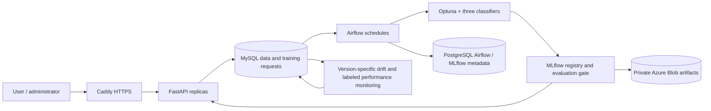

# Architecture

Each trained artifact contains the fitted preprocessor and classifier. Feature hashes assign stable splits; the three candidate algorithms use identical data. Validation AUC chooses a candidate; a separate holdout gates promotion against the incumbent. The loaded model remains available during background refresh and unsuccessful refreshes.

Dataset acceptance and retraining requests commit together. Airflow consumes pending requests through a database lease shared by scheduled and event-driven runs. Failures retry up to three attempts, then remain visible as failed. Monitoring binds both reference data and production windows to the deployed model version. Actual labels are supplied through feedback, never inferred from predictions.

Application data and metadata persist in Docker volumes; model artifacts and database dumps live in private Blob Storage. See [Azure operations](azure-operations.md) for actual resources, access, costs and recovery. The deployment currently uses one VM and is not resilient to loss of that VM without recovery.
